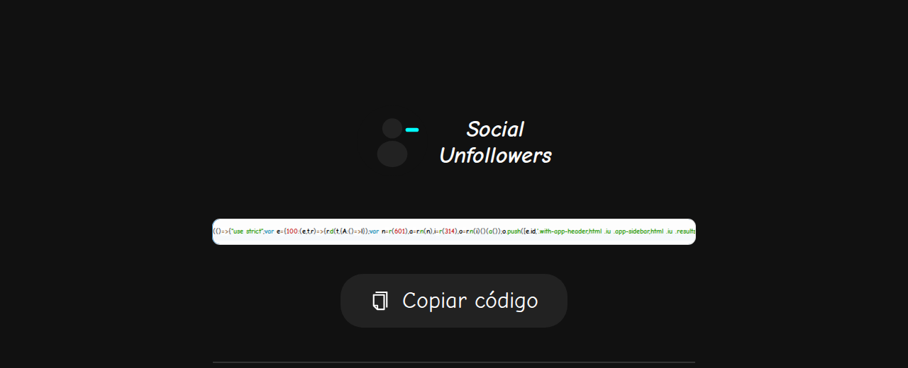
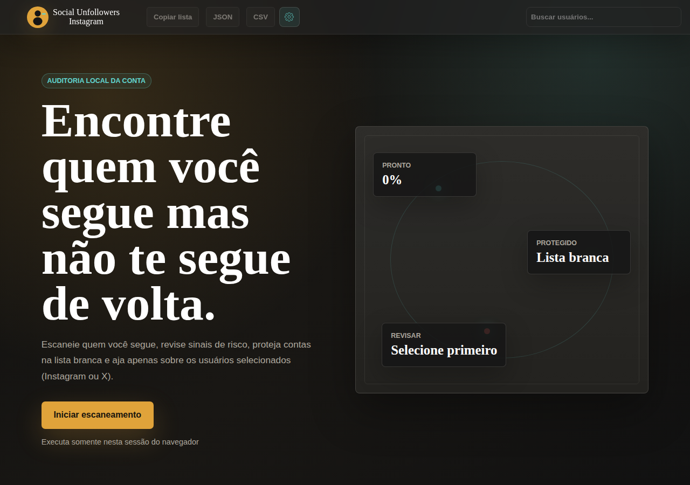
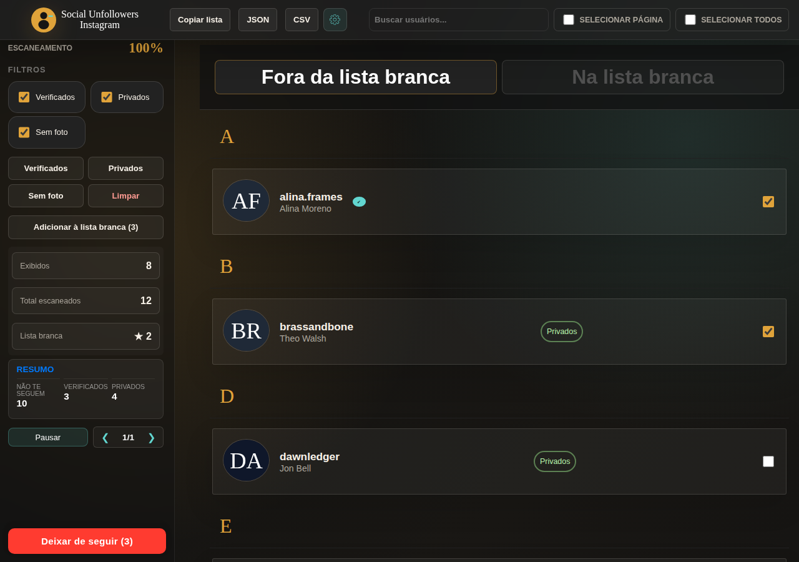
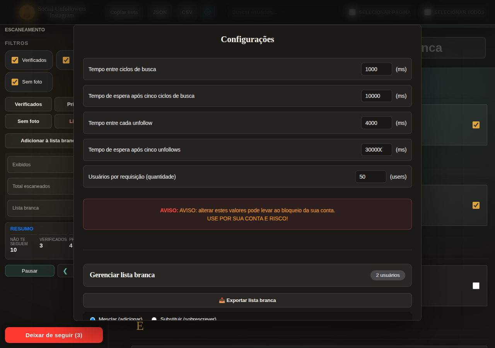
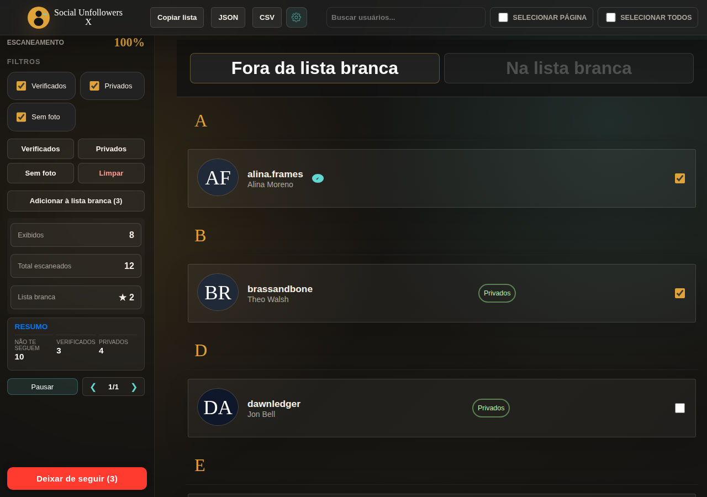

# Social Unfollowers

Ferramenta para descobrir **quem você segue mas não te segue de volta** no **Instagram** ou no **X.com**. Funciona **no navegador**, colando um script na console — sem instalar extensões nem enviar dados a servidores externos.

> **Transmissão ao vivo e cache:** as contas aparecem na tela em tempo real conforme cada lote é buscado. Escaneamentos concluídos ficam em cache local para reabrir a auditoria na hora, sem repetir chamadas desnecessárias à API.

## Uso no computador

1. Abra a página do script: [Social Unfollowers no GitHub Pages](https://gabrielfssantos.github.io/Social-Unfollowers/) (desenvolvedores: após `npm run build`, use o bundle em `public/index.html`).
2. Copie o código com o botão **Copiar código**.
    
3. Acesse [instagram.com](https://www.instagram.com) ou [x.com](https://x.com), faça login.
4. Abra o console do desenvolvedor:
   - Windows / Linux: `Ctrl + Shift + J`
   - macOS: `⌘ + ⌥ + I`
5. Cole o script e pressione `Enter`. A interface do Social Unfollowers será exibida.
   - Se o navegador pedir confirmação antes de colar, digite **`allow pasting`** (em inglês) na console e pressione Enter; depois cole de novo. É proteção padrão do Chrome/Edge — revise o código na [página do projeto](https://gabrielfssantos.github.io/Social-Unfollowers/) ou no repositório antes de colar.
    
6. Clique em **Iniciar escaneamento** (ou **Carregar escaneo anterior** para abrir resultados salvos).
7. Durante o escaneamento, as contas vão aparecendo e o status de follow-back é atualizado.
    
8. **Lista branca:** clique na foto do perfil para proteger contas do unfollow.
9. **Configurações:** exportar, importar, colar ou limpar a lista branca; ajustar intervalos entre requisições.
    
    
10. Marque os usuários desejados e use **Deixar de seguir** quando o escaneamento terminar.

O **mesmo** script detecta a rede pelo site aberto (`instagram.com` vs `x.com`). No X, o fluxo é equivalente (scan, lista branca, unfollow em fila).

 

Detalhes: [docs/documentation/17_fluxo_escaneamento_x.md](docs/documentation/17_fluxo_escaneamento_x.md). Problemas de sessão/401: [18_debug_x_sessao.md](docs/documentation/18_debug_x_sessao.md).

## Uso no celular (Android)

1. Instale o [Eruda Android Browser](https://github.com/liriliri/eruda-android/releases/).
2. Abra o Instagram web pelo Eruda.
3. Siga os mesmos passos do desktop (console via ícone do Eruda).

## Funcionalidades

- **Escaneamento:** identifica quem não te segue de volta.
- **Streaming progressivo:** resultados aparecem por lote, sem tela vazia em contas grandes.
- **Cache local:** reabra escaneamentos concluídos sem refazer tudo.
- **Proteção de sessão:** headers da web do Instagram (`X-ASBD-ID`, `X-CSRFToken`, etc.) para reduzir logouts forçados.
- **Action block:** valida respostas de unfollow e para a fila em `feedback_required`.
- **Rate limit:** pausas e backoff em HTTP 429 / 400.
- **Escaneamento incompleto:** unfollow em massa desabilitado se o scan foi interrompido.
- **Lista branca persistente:** JSON, import/export e colagem em massa de usernames.
- **Timings configuráveis** nas configurações.
- **Privacidade:** processamento 100% no navegador; nada é enviado a servidores do projeto.

## Documentação técnica

Guia completo do código, fluxos, API Instagram, build e gate:

**[docs/README.md](docs/README.md)**

## Desenvolvimento

- Node 16+ / 18+ / 20+
- `npm install`
- `npm run build` — gera `dist/dist.js`
- `npm run build-dev` — watch com recarga
- Preview local: `public/preview.html` (Instagram) ou `public/preview-x.html` (X)
- `npm run test:unit` — testes unitários (índice + parser X)
- `npm run e2e:record` — gravar sessão X (uma vez) → `e2e/.auth/storage-state.json`
- `npm run e2e:live` — smoke no preview; scan real no X se a sessão existir
- `npm run screenshots:readme` — regenerar PNGs em `assets/` (após `build`)

O workflow de CI atualiza o bundle embutido em `public/index.html`. Evite editar o bloco do script manualmente; textos da landing (fora do bundle) podem ser ajustados conforme [`docs/documentation/02_build_webpack_deploy_github_pages.md`](docs/documentation/02_build_webpack_deploy_github_pages.md).

## Origem e créditos

Este projeto é um **fork independente** derivado de [InstagramUnfollowers](https://github.com/davidarroyo1234/InstagramUnfollowers) por David Arroyo (licença MIT). O código original permanece sob copyright do autor upstream; as modificações e a manutenção desta linha são de Gabriel F. S. Santos. Detalhes: [NOTICE.md](NOTICE.md).

## Legal

**Aviso:** esta ferramenta **não** é afiliada ao Instagram/Meta nem ao X Corp.

**Use por sua conta e risco.** Automatizar ações pode violar os Termos de Uso da plataforma.

Licença: [MIT](LICENSE).
